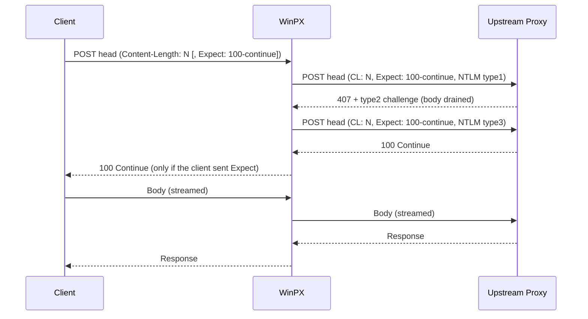

# WinPX Proxy Server

## Overview

WinPX is a local forwarding HTTP proxy.
Applications connect to it without credentials, and without knowledge of the system proxy configuration (such as PAC or WPAD).
WinPX forwards their requests depending on proxy auto-config and the destination, either directly, or to an enterprise upstream proxy.
When forwarding to an upstream proxy, WinPX authenticates there with the Windows credentials of the user running WinPX.

This document defines the  WinPX core proxy requirements. The goals are:

- A HTTP proxy that can forward requests.
- Is compliant with HTTP/1.1 and HTTP/1.0.
- Is compliant with
  - [RFC 1945: Hypertext Transfer Protocol -- HTTP/1.0](./rfc1945.txt)
  - [RFC 9110: STD 97: HTTP Semantics](./rfc9110.txt)
  - [RFC 9112: STD 99: HTTP/1.1](./rfc9112.txt)
  - [RFC 9931: Security Considerations for Optimistic Protocol Transitions in HTTP/1.1](./rfc9931.txt)
  - [RFC 7230: Hypertext Transfer Protocol (HTTP/1.1): Message Syntax and Routing](./rfc7230.txt) (obsoleted by RFC 9110/9112; background only, RFC 9110/9112 take precedence)
- Supports `Expect: 100-continue` semantics.
- Supports Basic, Digest, NTLM, and Negotiate/Kerberos authentication towards the upstream proxy.

### Scope

- In scope: forward proxy for `http://` requests (absolute-form) and `CONNECT` tunnels (authority-form), forwarded directly or via an upstream proxy chosen by PAC/WPAD.
- Out of scope:
  - Serving local resources. Requests in origin-form (`GET /path`) or asterisk-form (`OPTIONS *`) addressed to WinPX itself are rejected (see S2.4).
  - `Upgrade` on plain `http://` requests (for example WebSocket over `ws://`). `Upgrade` is stripped; WebSocket and other tunnels work only via `CONNECT`.
  - HTTP/2 and HTTP/3 on the client or upstream side.
  - TLS interception. `CONNECT` tunnels are relayed opaquely.
- Origin server authentication (`401`, `WWW-Authenticate`, `Authorization`) is end-to-end and passed through unchanged. WinPX only handles upstream proxy authentication (`407`, `Proxy-Authenticate`, `Proxy-Authorization`).
- Basic and Digest credentials for the upstream proxy come from the WinPX configuration file. NTLM and Negotiate use the Windows credentials of the user running WinPX (SSPI).

## Background

### Proxy authentication is connection-based

- NTLM and Negotiate authenticate the **TCP connection** to the upstream proxy, not each request. After the handshake succeeds, later requests on the same keep-alive connection need no further authentication.
- Kerberos (Negotiate) usually completes in **one leg**: the token sent with the first request is enough.
- NTLM (or Negotiate falling back to NTLM) takes **multiple legs** on the **same connection**: type-1 → `407` with type-2 challenge → type-3. Closing the connection between legs breaks the handshake.

### Authentication is optional on the upstream side

The upstream proxy may not require authentication for every destination (bypass lists, allow-listed hosts, intranet ranges). Any request sent upstream, including a handshake leg, **may be forwarded to the origin server**. A handshake request with `Content-Length: 0` is therefore only safe when a `407` is guaranteed. Otherwise it delivers an empty request (for example an empty POST) to the origin, and the body that follows is read as a new, malformed request.

### The client socket cannot be rewound

libcurl handles a `407` in the middle of an upload by rewinding its body source (`CURLOPT_SEEKFUNCTION`) and sending the body again. WinPX reads the body from a client socket and cannot rewind it. Once body bytes have been forwarded upstream, WinPX can only replay them if it buffered them.

### `Expect: 100-continue` semantics (RFC 9110, section 10.1.1)

- A client that sends `Expect: 100-continue` waits for `100 Continue` or a final status before sending the body. It **may** send the body anyway after a timeout (curl waits about 1 second).
- A server that sends a final status without reading the body must either read and discard the body or close the connection.
- `Expect` is an end-to-end header and must be forwarded.
- If a proxy knows the next hop only supports HTTP/1.0, it may send `100 Continue` to the client immediately.

## Requirements

### R1 Reading the client request

- R1.1 Read only the request head (request line and headers, up to and including the first `\r\n\r\n`) before making any upstream decision.
- R1.2 Determine the body framing from the head: `Transfer-Encoding: chunked`, `Content-Length`, or no body.
- R1.3 Do not read the request body from the client socket until the upstream connection is ready to receive it (see R4). Unread body bytes stay in the TCP receive buffer, which applies backpressure to the client.
- R1.4 Strip hop-by-hop headers before forwarding (RFC 9110 7.6.1): `Connection`, every header named in `Connection`, `Proxy-Connection`, `Proxy-Authorization`, `Proxy-Authenticate`, `Keep-Alive`, `TE`, `Trailer`, `Upgrade`. This applies to requests and responses. Keep `Expect`, `Authorization`, and `WWW-Authenticate` (end-to-end).

### R2 Upstream connection selection

- R2.1 Prefer a pooled keep-alive upstream connection that is **already authenticated**. On such a connection, send the full request (head and streamed body) with no handshake.
- R2.2 Return upstream connections to the pool after a complete response when both sides allow keep-alive.
- R2.3 Remember per upstream proxy (and per destination host, if bypass rules apply) whether a `407` was received before (the "auth required" state). Use this only as a hint. It never permits sending an empty-body request unless R3.3 applies.

### R3 Authentication on a new upstream connection

- R3.1 **Kerberos (Negotiate, single leg).** Send the real head with `Proxy-Authorization: Negotiate <token>` and the real body framing. Then follow R4 for the body. If the proxy ignores the token, the request is still correct.
- R3.2 **NTLM (multi-leg), safe default.** Send the real head with the real framing, `Proxy-Authorization: NTLM <type1>`, and `Expect: 100-continue`. Do not send the body yet.
  - On `407` with a challenge: read and discard the `407` body completely, then send the real head again with `Proxy-Authorization: NTLM <type3>` and `Expect: 100-continue` on the same connection.
  - On `100 Continue`: the upstream accepted the request (no authentication needed, or authentication succeeded). Continue with R4.
  - On any other final status: forward it to the client (see R5) without sending the body.
- R3.3 **Empty-body handshake.** Sending the type-1 leg with `Content-Length: 0` (and no body) is allowed **only** for requests without a body (GET, HEAD, `CONNECT`, `Content-Length: 0`). Never use it for requests that have a body, because the upstream may forward it to the origin.
- R3.4 Consume each `407` response completely (`Content-Length`, chunked, or close-delimited) before sending the next leg. If the `407` asks to close the connection (`Connection: close`) during an NTLM handshake, start over on a new connection, at most once.
- R3.5 Bound the handshake: at most one complete handshake retry per request. If authentication still fails, reply `502 Bad Gateway` to the client (or a WinPX-generated `407` with an explanatory body, if configured).
- R3.6 **Basic.** Credentials from the configuration file. Basic is a single leg and not bound to the connection, so `Proxy-Authorization: Basic` may be sent preemptively on every request to an upstream proxy known to require it (R2.3). Never send Basic credentials to a direct destination.
- R3.7 **Digest.** Credentials from the configuration file. Requires a challenge (nonce) from a `407`, so it follows the R3.2 pattern (real head, `Expect: 100-continue`, no empty body). The nonce may be reused on later requests and connections until the proxy reports `stale=true`.
- R3.8 **Scheme selection.** Choose the strongest scheme offered in `Proxy-Authenticate` that WinPX can use: Negotiate, NTLM, Digest, Basic. A proxy may offer several challenges in one or several header fields (RFC 9110 11.6.1).

### R4 Forwarding the request body

- R4.1 **Client sent `Expect: 100-continue`.**
  - Do not send `100 Continue` to the client immediately.
  - Forward `Expect: 100-continue` upstream and complete authentication on the head alone (R3).
  - Relay `100 Continue` to the client only when the upstream sends `100` for the final (authenticated) request, or when the upstream `Expect` timeout (R4.4) expires. Then stream the body upstream.
  - `100` responses received during intermediate handshake legs are not relayed to the client.
  - If the upstream answers with a final status, forward it to the client without the body and apply R5.3.
- R4.2 **Client did not send `Expect`, request has a body, connection not yet authenticated.**
  - WinPX adds `Expect: 100-continue` to the upstream request and does not read the client body until the upstream sends `100` or the `Expect` timeout expires.
  - Remove the WinPX-added `Expect` handling from anything sent back to the client: WinPX consumes the upstream `100` and does not send `100` to a client that did not ask for it.
- R4.3 **Connection already authenticated (R2.1).** Stream the body immediately, chunk by chunk, preserving the original framing (copy `Content-Length` bodies and chunked bodies, including trailers, as is). If the client sent `Expect: 100-continue`, forward it and relay the upstream `100` as usual.
- R4.4 **Upstream ignores `Expect`.** If no response arrives within the upstream `Expect` timeout, start sending the body. The timeout must be longer than typical client timeouts (default: 3 seconds, configurable).
- R4.5 **Bounded replay buffer.** While streaming a body on a connection that is not yet confirmed as authenticated (after an `Expect` timeout, or when the upstream is known to be HTTP/1.0), keep the forwarded bytes in a replay buffer up to a configurable limit (default: 1 MB).
  - If a late `407` arrives and the whole body fits in the buffer: finish or abort the upload, complete the handshake, and replay the request from the buffer.
  - If the body exceeded the buffer: the request cannot be replayed. Close the upstream connection and reply `502 Bad Gateway` to the client.
  - Release the buffer as soon as the upstream sends a non-`407` response.
- R4.6 **Body sent early by the client.** If the client starts sending the body before WinPX sent `100 Continue` (client timeout), do not read it until the upstream is ready (R1.3). If bytes were already read, keep them for R4.5 and forward them after authentication.
- R4.7 **HTTP/1.0 upstream.** If the upstream proxy is known to speak HTTP/1.0 only, `Expect` cannot be used. Read the body into the replay buffer (R4.5) and send the full request. If the body exceeds the limit, reply `417 Expectation Failed` (client sent `Expect`) or `502 Bad Gateway`.

### R5 Relaying the response

- R5.1 Never forward a `407` from the upstream proxy to the client.
- R5.2 Forward all other responses, including `1xx` responses for the final request (except a `100` WinPX requested itself, see R4.2).
- R5.3 When a final response is sent before the client body was read (for example `413`, `417`, `3xx`, `401` from the origin), the client may still send the body. Either read and discard exactly the announced body, or close the client connection after the response. Never interpret leftover body bytes as the next request.
- R5.4 After a complete exchange, keep the client and upstream connections alive when both allow it.

### R6 `CONNECT` (HTTPS tunnels)

- R6.1 `CONNECT` has no body. Use the empty-body handshake (R3.3): send `CONNECT` with the authentication leg, discard `407` bodies, and repeat on the same connection.
- R6.2 After `200`, reply `200 Connection established` to the client and relay bytes in both directions until either side closes.
- R6.3 If authentication fails, reply `502 Bad Gateway`. Do not forward `407`.
- R6.4 **Wait for `2xx` before tunneling (RFC 9931 section 8).** WinPX sends `CONNECT` on behalf of untrusted clients, so it must not forward any tunnel payload upstream before the upstream proxy answered `2xx`. Bytes the client sends early (optimistic TLS `ClientHello`) stay in the client socket (R1.3) or in a bounded buffer and are forwarded only after `2xx`.
- R6.5 **Upstream closes after rejecting `CONNECT`.** RFC 9931 requires proxies to close the connection after rejecting a `CONNECT`, including with `407`. WinPX must handle a closed connection after a `CONNECT` `407`: continue the handshake on a new connection. NTLM needs the same connection for all legs, so if the upstream closes after the type-2 challenge, NTLM over `CONNECT` cannot complete. Fall back to Kerberos or Basic/Digest if offered, otherwise reply `502`.
- R6.6 **WinPX rejecting `CONNECT`.** When WinPX itself rejects a client `CONNECT` (bad target, policy, upstream failure), it sends the error response with `Connection: close` and closes the client connection without reading further requests (RFC 9931 section 8).
- R6.7 `CONNECT` targets must be in authority-form `host:port` with a valid, non-empty port (1-65535). Otherwise reply `400` (RFC 9110 9.3.6).
- R6.8 A `2xx` response to `CONNECT` has no body. `Content-Length` or `Transfer-Encoding` in it are ignored (RFC 9112 6.3).

### R7 Message forwarding (RFC 9110, RFC 9112)

- R7.1 **Request target.** Accept absolute-form (`http://host[:port]/path`) for normal requests and authority-form for `CONNECT` only. Reject `https://` in absolute-form with `400`, since WinPX does not originate TLS (clients use `CONNECT`).
- R7.2 **Host.** For absolute-form requests, the authority in the target wins; replace the `Host` header with it (RFC 9112 3.2.2). HTTP/1.1 requests without exactly one `Host` header get `400` (RFC 9112 3.2).
- R7.3 **Forward to an upstream proxy:** keep absolute-form. **Forward directly to the origin:** convert to origin-form (`/path?query`, `/` if empty) and send `Host` (RFC 9112 3.2.1).
- R7.4 **Version.** WinPX sends its own version (`HTTP/1.1`) on outbound messages, not the client's (RFC 9110 2.5, 6.2).
- R7.5 **Via.** Add `Via: 1.1 winpx` (or `1.0 winpx` for HTTP/1.0 messages) to forwarded requests and responses (RFC 9110 7.6.3).
- R7.6 **Max-Forwards.** For `TRACE` and `OPTIONS`: if `Max-Forwards` is `0`, answer locally; otherwise decrement it before forwarding (RFC 9110 7.6.2).
- R7.7 **Response body length** (RFC 9112 6.3): no body for responses to `HEAD`, `1xx`, `204`, `304`, and `2xx` to `CONNECT`; otherwise chunked, `Content-Length`, or read until close. A close-delimited response forces the client connection to close after relaying it (or re-encoding as chunked for HTTP/1.1 clients).
- R7.8 **Trailers.** Forward chunked bodies including trailers unchanged to HTTP/1.1 peers. When de-chunking for an HTTP/1.0 client, discard trailers.
- R7.9 **Persistence** (RFC 9112 9.3): HTTP/1.1 connections are persistent unless `Connection: close`. HTTP/1.0 connections are persistent only with `Connection: keep-alive`. Client and upstream connections are managed independently.
- R7.10 **Pipelining.** Clients may pipeline requests. Process them strictly in order, one at a time, and send responses in the same order (RFC 9112 9.3.2). Do not read the next request head before the current request body has been fully consumed.
- R7.11 **Retries.** Automatically retry a request on a new upstream connection only if it is idempotent (`GET`, `HEAD`, `OPTIONS`, `TRACE`, `PUT`, `DELETE`) and no response byte was received, or if the request body was never sent (`Expect` rejected). Never retry a non-idempotent request whose body may have reached the origin (RFC 9110 9.2.2, RFC 9112 9.3.1).
- R7.12 **Upgrade.** Strip `Upgrade` and the `upgrade` connection option. A `101` from upstream (not requested) is treated as an invalid response (`502`).
- R7.13 **Interim responses.** Forward `1xx` to HTTP/1.1 clients (except `100` that WinPX requested itself, R4.2, and `101`). Never send `1xx` to HTTP/1.0 clients (RFC 9110 15.2).

### R8 HTTP/1.0 clients (RFC 1945)

- R8.1 Accept HTTP/1.0 requests. `Host` is optional; use the absolute-form authority.
- R8.2 HTTP/1.0 requests must use `Content-Length` for bodies. A request with `Transfer-Encoding` and version 1.0 is treated as faulty framing: reply `400` and close (RFC 9112 6.1).
- R8.3 Responses to HTTP/1.0 clients must not use chunked encoding. De-chunk and either send close-delimited (then close) or, if keep-alive was requested and the length is known, send `Content-Length`.
- R8.4 `Expect: 100-continue` from an HTTP/1.0 client is ignored (RFC 9110 10.1.1).

### R9 Direct connections

- R9.1 When PAC/WPAD returns `DIRECT`, connect to the destination directly. No proxy authentication takes place, so R3 and the `Expect` insertion of R4.2 do not apply; stream the body immediately.
- R9.2 Try all resolved addresses (IPv6 and IPv4) before failing. Connection failure gives `502`, timeout gives `504`.
- R9.3 When PAC returns a list (`PROXY a; PROXY b; DIRECT`), fail over to the next entry only if no request byte has been sent, or if R7.11 permits a retry.

## Security

WinPX authenticates with the user's credentials on behalf of anyone who can connect to it. Every client is therefore untrusted, and every parsing ambiguity between WinPX and the upstream proxy or origin is a potential request smuggling vector.

### S1 Listener and access control

- S1.1 Listen modes (configurable):
  - `loopback` (default): `127.0.0.1` and `::1` only.
  - `loopback+wsl`: loopback plus the WSL virtual network interface (`vEthernet (WSL)`); accept only peers from the WSL subnet.
  - `any`: all interfaces. Requires an explicit configuration change, and a warning is logged at startup, because any host that can reach the port can use the user's enterprise credentials.
- S1.2 Check the peer address of every accepted connection against the active mode and close non-matching connections immediately, without sending a response.
- S1.3 Never forward requests whose destination is WinPX's own listen address and port (proxy loops). Reply `508 Loop Detected` or `400`. Also detect loops via a `Via` header that already contains WinPX's own entry.
- S1.4 Credentials from the configuration file (Basic/Digest) are only sent to the configured upstream proxy, never to an origin server or a PAC-selected host that does not match the configured proxy. Never log credentials or `Proxy-Authorization` values.

### S2 Request head parsing (RFC 9112 2, 3, 5)

Malformed requests are rejected with `400 Bad Request` and `Connection: close`, and the client connection is closed. WinPX never attempts to repair or forward an ambiguous message.

- S2.1 **Line endings.** Lines end with CRLF. A bare LF may be accepted as a line terminator; a bare CR anywhere in the head is an error (RFC 9112 2.2).
- S2.2 **Leading empty lines.** Ignore at least one empty line (CRLF) before the request line (RFC 9112 2.2). Reject any other data before the request line.
- S2.3 **Request line.** Exactly `method SP request-target SP HTTP-version`, single spaces. The method is a token; the version matches `HTTP/1.0` or `HTTP/1.1`. Other `HTTP/1.x` minor versions are treated as `1.1`; any other version gets `505 HTTP Version Not Supported`.
- S2.4 **Request target.** Absolute-form `http://` URI, or authority-form for `CONNECT` only. Origin-form, asterisk-form, `CONNECT` with a non-authority target, and non-`CONNECT` with authority-form get `400`. Reject targets containing whitespace, control characters, or a fragment (`#`). Reject userinfo (`user@host`) in the authority (RFC 9110 4.2.4).
- S2.5 **Header fields.** `name: value` where the name is a token. Whitespace between the field name and the colon gets `400` (RFC 9112 5.1). Whitespace between the request line and the first header field gets `400` (RFC 9112 2.2).
- S2.6 **Obsolete line folding** (`obs-fold`, continuation lines starting with SP/HTAB) gets `400` (RFC 9112 5.2).
- S2.7 **Field values.** Reject CR, LF, and NUL in field values (RFC 9110 5.5). Trim leading and trailing SP/HTAB.
- S2.8 **Duplicate singleton fields.** More than one `Host` gets `400`. Multiple `Content-Length` values (in one or several fields) are accepted only if all are identical valid numbers, then collapsed to one; otherwise `400` (RFC 9112 6.3).
- S2.9 **Host consistency.** For absolute-form, the target authority replaces `Host` (R7.2). The host must be a valid reg-name, IPv4, or bracketed IPv6 literal, and the port 1-65535.

### S3 Message framing (request smuggling, RFC 9112 6 and 11.2)

- S3.1 **`Transfer-Encoding` and `Content-Length` together.** The request is rejected with `400` and the connection closed. (RFC 9112 6.3 allows processing by `Transfer-Encoding` and closing afterwards; WinPX chooses the stricter option, because it forwards the message.)
- S3.2 **`Transfer-Encoding` other than exactly `chunked`.** WinPX only accepts `chunked` as the sole, final coding in requests. Any other value, unknown coding, list where `chunked` is not last, or `chunked` applied more than once gets `501 Not Implemented` or `400`, and the connection is closed.
- S3.3 **`Content-Length` syntax.** One or more ASCII digits only; no sign, no whitespace inside, no hex. Values that overflow 64 bits get `400`.
- S3.4 **Chunked parsing.** Chunk size is hex digits only (bounded to 16 digits, no overflow). Chunk extensions are parsed and discarded on forwarding, with a length limit. Each chunk ends with exactly CRLF. Trailer fields obey the S2 rules; trailers are never merged into the header section.
- S3.5 **Forward re-framed.** WinPX forwards the body using the framing it parsed (exactly one `Content-Length`, or `Transfer-Encoding: chunked`), never the client's raw framing headers, so the upstream cannot interpret the message differently.
- S3.6 **Incomplete messages.** If the client closes before the declared body is complete, close the upstream connection (never return it to the pool), so the origin does not see a truncated request completed by the next request.
- S3.7 **Response framing.** The same rules apply to responses from upstream. An invalid or ambiguous response (conflicting `Content-Length`, invalid chunking, bad status line) results in `502` to the client, and the upstream connection is closed and discarded. A response with both `Transfer-Encoding` and `Content-Length` is read using `Transfer-Encoding`, `Content-Length` is removed, and the upstream connection is closed afterwards (RFC 9112 6.3).
- S3.8 **Leftover bytes.** After a response that ended the exchange early (R5.3), discard exactly the declared request body or close. Bytes left over on an upstream connection after a complete response (unsolicited data) cause the connection to be closed, not pooled.

### S4 Connection state and pooling

- S4.1 An upstream connection is returned to the pool only if the request and response were both completely transferred and neither side requested close.
- S4.2 Authenticated upstream connections are bound to the identity used (Windows user, configured Basic/Digest account) and to the upstream proxy. They are never reused for a different upstream proxy or a `DIRECT` destination.
- S4.3 A pooled connection that fails before any response byte is received may be retried per R7.11 only.
- S4.4 After `CONNECT` succeeds, the client connection is a raw tunnel and is never parsed as HTTP again. After `CONNECT` is rejected, the client connection is closed (R6.6).

### S5 Resource limits (denial of service)

- S5.1 Limits, all configurable, with `431 Request Header Fields Too Large` or `400`/`414` responses as appropriate:
  - Request line length (`414 URI Too Long`).
  - Single header field length and total header section size (`431`).
  - Number of header fields (`431`).
  - Chunk extension and trailer section size (`400`).
- S5.2 Timeouts: client head read timeout (slowloris), client body idle timeout, upstream connect timeout (`504`), upstream response head timeout (`504`), idle keep-alive timeout for client and pooled connections, tunnel idle timeout.
- S5.3 Limit concurrent client connections and concurrent upstream connections per upstream proxy.
- S5.4 Replay buffers (R4.5) and early `CONNECT` data buffers (R6.4) are bounded; exceeding the limit never grows memory, it falls back to closing or `502`.
- S5.5 Bound the number of `407` legs per request (R3.5) to prevent authentication loops with a misbehaving upstream.

### S6 Error responses

- S6.1 Error responses generated by WinPX contain a minimal, static body (no reflection of request data, to avoid injection into browsers) and `Connection: close` for parsing errors.
- S6.2 Status codes used by WinPX: `400` malformed request, `414` request line too long, `431` header section too large, `501` unsupported transfer coding, `502` upstream failure or authentication failure, `504` upstream timeout, `505` unsupported HTTP version, `508` proxy loop.
- S6.3 Upstream `407` and its `Proxy-Authenticate` headers are never forwarded (R5.1), so clients are never prompted for, or exposed to, the user's enterprise credentials.

## Implementation Notes

### Decision table

| Case | Upstream connection | Body | Client `Expect` | Strategy |
|---|---|---|---|---|
| 1 | Authenticated (pooled) | Any | Any | Send head; stream body (relay upstream `100` if client asked for it) |
| 2 | New | None (GET, HEAD, CL 0) | – | Handshake with real head, empty body (R3.3) |
| 3 | New | Yes | Yes | Forward head with `Expect`; finish handshake on head; relay `100` from final leg; stream body (R4.1) |
| 4 | New | Yes | No | Add `Expect` upstream; finish handshake on head; consume upstream `100`; stream body (R4.2) |
| 5 | New, Kerberos | Yes | Any | Single leg with token + `Expect`; stream body after `100` or timeout |
| 6 | New, upstream ignores `Expect` | Yes | Any | Stream after timeout with bounded replay buffer; replay on late `407` or reply `502` (R4.4, R4.5) |
| 7 | New, HTTP/1.0 upstream | Yes | Any | Buffer body up to limit, send full request, replay on `407`; else `417` / `502` (R4.7) |
| 8 | `CONNECT` | None | – | Empty-body handshake, then tunnel (R6) |

### Sequence: new connection, NTLM, POST with body

### Comparison with libcurl

- libcurl sends a bodyless request (`Content-Length: 0`) only during a multi-leg handshake it knows is in progress. If the application forces `CURLAUTH_NTLM`, libcurl may send an empty POST through a proxy that does not challenge it. WinPX must not do this (R3.3).
- libcurl adds `Expect: 100-continue` to large uploads and does not send the body if a `401`/`407` arrives first. WinPX does the same for every unauthenticated request with a body (R4.2).
- libcurl rewinds its body source after a mid-upload `407` (`CURLE_SEND_FAIL_REWIND` if impossible). WinPX uses a bounded replay buffer instead (R4.5).
- libcurl reuses authenticated connections. WinPX pools authenticated upstream connections (R2.1).

### Configuration

| Setting | Default | Used by |
|---|---|---|
| Upstream `Expect` timeout | 3 s | R4.4 |
| Replay buffer limit | 1 MB | R4.5, R4.7 |
| Max handshake retries per request | 1 | R3.5 |
| Listen mode | `loopback` | S1.1 |
| Max request line length | 8 KB | S5.1 |
| Max header section size | 64 KB | S5.1 |
| Max header field count | 100 | S5.1 |
| Client head read timeout | 30 s | S5.2 |
| Upstream connect timeout | 30 s | S5.2 |
| Idle keep-alive timeout | 60 s | S5.2 |

